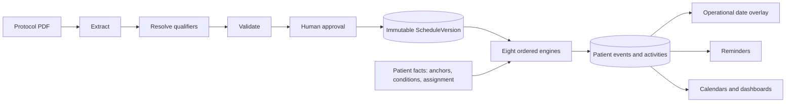
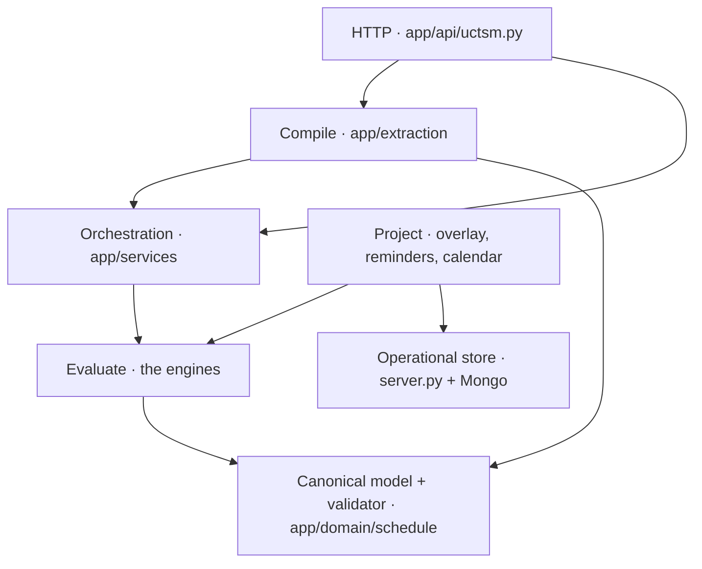
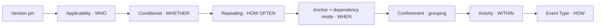

# Architecture Spine — MTB Scheduling Subsystem

Reader's note: `[TARGET]` marks a rule the code does not yet satisfy — it is the contract to build to, not a description of today. Everything unmarked ratifies what the code already does.

## Design Paradigm

**Compile–Evaluate–Project**, one-way.

- **Compile** turns a protocol PDF into an immutable, approved `ScheduleVersion`: extract → resolve qualifiers → validate → human approval. Runs once per protocol version. Knows nothing about patients.
- **Evaluate** takes a pinned `ScheduleVersion` plus patient facts and produces that patient's events and activities. Runs whenever a patient fact changes. Writes no protocol meaning.
- **Project** turns patient rows into what people see — the operational date overlay, reminders, calendars, dashboards. Formats; never derives.

Layer map: Compile = `backend/app/extraction/`; the canonical model and the engines = `backend/app/domain/schedule/`; orchestration and transactions = `backend/app/services/`; Project = `app/services/schedule_projection.py`, `operational_read.py`, and the Mongo path in `backend/server.py`.



## Invariants & Rules

Dependency direction — arrows mean *depends on*. The canonical model is a leaf and depends on nothing; that is the rule, not an accident. Compile depends on services only for its transactional boundary (`extraction/runner.py` → `services/extraction_service.py`); that single edge is the orchestration seam and no other Compile module may take one.



### AD-1 — Dual store, time-boxed read-authority migration `[PROPOSED — awaiting ratification]`

- **Binds:** all patient visit reads and writes; `Trial.schedule_read_mode`; `UCTSM_AUTHORITATIVE`
- **Prevents:** two schedule-*authoring* paths surviving indefinitely — and the opposite error of deleting the operational store, which owns workflow state the engine deliberately does not model
- **Rule:** The canonical engine is the sole authority for schedule *meaning and dates*. `visit_instances` remains the permanent system of record for operational workflow state — comments, tasks, completion, site edits — and the engine never acquires equivalents. `schedule_read_mode` is a migration flag with a terminal state, not permanent configuration: every trial moves to `ENGINE` through the parity gate, after which `UCTSM_AUTHORITATIVE` is switched on permanently and legacy schedule *authoring* is deleted. Reverting a trial to `LEGACY` stays ungated forever.

### AD-1a — Parity differences can be adjudicated, not only matched `[TARGET]`

- **Binds:** `ParityRun`, `ParityService.readiness`
- **Prevents:** a trial that can never cut over because the only route to `MATCH` is making the engine reproduce a date the legacy path invented
- **Rule:** `ParityRun` carries a reviewer decision — `ACCEPTED`, with actor and reason — distinct from the computed `MATCH`. `readiness()` passes a patient on `MATCH ∨ ACCEPTED`. No auto-accept, no bulk accept, no accept without a reason. Adjudication is per patient per schedule version and is invalidated by a new version exactly as a run is.

### AD-1b — The canonical side writes dates and nothing else into operational documents `[TARGET]`

- **Binds:** `operational_read.py`, `operational_projection.py`, any future canonical→operational writer
- **Prevents:** an upsert carrying empty workflow keys blanking a site's comment thread or task list — the single loss AD-1 exists to prevent
- **Rule:** The set of operational fields the canonical side may write is enumerated and closed: `scheduled_date`, `window_start`, `window_end`, plus the `uctsm_*` provenance markers. A canonical→operational payload MUST NOT contain a workflow key at all — not populated, not empty, not null. Any writer emitting a full document shape is a defect, not a configuration choice.

### AD-2 — One canonical-native extraction pipeline `[ADOPTED]`

- **Binds:** all protocol extraction
- **Prevents:** paying a schedule-shape translation layer forever, and inferring downstream the semantics the specification requires to be extracted
- **Rule:** Extraction emits `UniversalSchedule` directly. There is exactly one schedule shape and no translation layer. `canonical_import.py` and `canonical_bridge.py` are deleted once nothing produces a `CanonicalSchedulePlan`. Every semantic the ten engines consume — dependency mode, conditional definitions, scoped qualifiers, activity anchors, confinement structure, dimensions, event mode — is an extraction *output*, never a downstream inference. This binds the canonical model too: a resolver that recovers a missing value by matching on a name or a convention (as `schedule_origin_anchor()` does today for Day 0) is such an inference and must be replaced by an extracted, evidence-linked value.

### AD-2a — Ingestion is a provider-agnostic port with a mandatory image fallback `[TARGET]`

- **Binds:** extraction input
- **Prevents:** a rebuild that silently loses scanned-protocol support and produces a confident schedule from an empty text layer
- **Rule:** Document ingestion is a port with two implementations behind one interface: embedded-text extraction and page-image rendering. A page whose text layer is empty MUST route to page-image; extraction may never proceed on empty text. `_render_pdf_pages` is salvaged out of `protocol_extraction.py` before that file is deleted. Model providers sit behind the same port boundary — no engine or service imports a provider directly.

### AD-2b — Extraction never produces a patient date

- **Binds:** extraction, all engines
- **Prevents:** a protocol-level artefact carrying a date only a patient fact can justify
- **Rule:** Extraction produces rules, structure and evidence. No extraction output may contain a patient-specific date or time. Dates exist only after Evaluate, and only from a patient fact.

### AD-3 — The three phases are separate and one-way

- **Binds:** all
- **Prevents:** runtime code mutating protocol meaning; presentation rules leaking into evaluation
- **Rule:** Compile writes an immutable `ScheduleVersion` and never reads patient data. Evaluate reads a pinned version plus patient facts and writes only patient rows. Project reads patient rows and writes nothing back into either. **Project may format, never derive:** a due-window, an attendance expectation or a reminder's wording is computed once in Evaluate and stored — a projector that recomputes it is a second implementation and a defect. There are no backward edges: a correction to protocol meaning is a new version, never an edit.

### AD-4a — Single-writer field ownership, binding every code path

- **Binds:** every module that writes a patient event or activity — engines, services, HTTP handlers and projectors alike
- **Prevents:** two writers on one field with last-write-wins; and the subtler case where one status column's *members* have different owners, so a site's completion and an amendment's cancellation destroy each other
- **Rule:** Ownership is per field, and where a field is a status enum, per **member**. It binds any code path, not only code inside an engine — a service or route writing an owned field is the same defect as an engine doing it.

| Field | Sole writer |
| --- | --- |
| `nominal_start_date`, `earliest_date`, `latest_date` | Anchor |
| membership of the patient's event set | Applicability |
| `occurrence_index` and occurrence count | Repeating |
| activity `planned_time` | Activity |
| episode grouping, study-day membership | Confinement |
| `visit_mode` — selection among `allowed_visit_modes` | Event Type |
| `requires_attendance`, reminder text | Event Type, materialized in Evaluate (per AD-3) |

  **Status members must be enumerated before build.** Every member of `PatientEventStatus`, `PatientActivityStatus` and `ConfinementStatus` is assigned exactly one owner in a table extending this AD. Until a member appears there with an owner, no code may write it. Members representing operational reality rather than protocol meaning — completion, missed — belong to the operational store and are written by no engine.

  **Protecting history is additive, never substitutive.** A materializer preserving a protected row's date writes a separate frozen field; it never substitutes a prior value into a column Anchor owns. Two readers must never be able to get two different due-dates for one visit.

### AD-4b — Dependency mode is a parameter, not an engine

- **Binds:** `DependencyMode`, Anchor, Repeating
- **Prevents:** a fifth date-writer competing with Anchor
- **Rule:** `DependencyMode` selects *which anchor value* Anchor reads — planned or actual — and writes nothing itself. `UNCLEAR` blocks approval; it is never resolved by defaulting to either mode.

### AD-4c — Qualifier resolution is compile-time and has no runtime authority

- **Binds:** the Footnote/Qualifier engine
- **Prevents:** a footnote surviving as decorative text while the rule it states never reaches a schedule structure
- **Rule:** Qualifier resolution writes *into* the other engines' definitions during Compile — a timing qualifier becomes an activity anchor, an applicability qualifier becomes an applicability rule — and then blocks approval on any unresolved marker, orphan footnote, or unresolved scope. At Evaluate it has no authority and is not consulted.

### AD-4d — Version is the outermost scope, resolved once

- **Binds:** all engines, all services touching a patient schedule
- **Prevents:** an amendment silently re-dating a patient already on study; and the subtler drift of several version handles disagreeing inside one call
- **Rule:** `Patient.current_schedule_version_id` is the single version handle. It is resolved once at the top of Evaluate and passed down; no engine and no service re-resolves it, and none may read "the trial's current version." `[TARGET]` Where multiple version handles exist today, they collapse to this one — a function may not read two.

### AD-4e — Fixed engine composition order

- **Binds:** the evaluator
- **Prevents:** order-dependent results — Conditional cancelling what Repeating already extended, or Repeating generating cycles for an arm the patient is not in
- **Rule:** Engines compose in this order and no other.



### AD-4f — One canonical identity for a materialized occurrence `[TARGET]`

- **Binds:** `logical_key` / `logical_occurrence_id` construction everywhere
- **Prevents:** recorded actuals failing to join back to the evaluated occurrence they belong to, silently — the join looks fine and simply returns nothing
- **Rule:** The identity of a materialized occurrence is constructed in exactly one function, used by every writer and every reader. No module composes the key inline. A change to its shape is a migration, not an edit.

### AD-5 — Nothing unstated is ever defaulted

- **Binds:** extraction, every engine, every screen
- **Prevents:** a plausible-looking date, mode, cadence or maximum that no protocol states — the failure the whole subsystem exists to avoid
- **Rule:** A value the protocol does not state resolves to `UNRESOLVED`, `AWAITING_ANCHOR`, or a blocking validation issue naming what is missing — never to a default, a substituted anchor, today's date, or an invented maximum. **Enforcement point:** a field carrying protocol meaning is declared without a default in the model, so an unstated value is structurally absent rather than silently plausible; the validator's blocking checks are the test. A default is permitted only where it encodes no protocol claim, and each such exemption is listed in the model with the reason it makes no claim.

### AD-6 — Closed taxonomies wherever the specification defines one `[TARGET]`

- **Binds:** the enums in `app/domain/schedule/models.py`
- **Prevents:** distinct protocol meanings collapsing into one stored value, which no later reviewer can recover
- **Rule:** Where the specification defines a value set, the model uses a closed enum with an explicit escape member, and an unrecognised value raises a review warning rather than being coerced. Specifically: `event_type` becomes a closed taxonomy (doc 10 s3) instead of the free string it is today; `QualifierScope.BLOCK` splits into `VISIT_BLOCK` and `SCHEDULE_BLOCK` (doc 7 s8); `QualifierCategory` gains `ARM_RESTRICTION`, `COHORT_RESTRICTION` and `COUNTRY_RESTRICTION` so a dimensional footnote reaches applicability with its dimension intact (doc 7 s9, doc 8 s13); `ScheduleStatus` gains the enrolment-lifecycle states (doc 9 s34); `ConfinementStatus` gains `DISCHARGE_PLANNED` (doc 6 s36).

### AD-7 — Applicability compares, it does not only match membership `[TARGET]`

- **Binds:** the Applicability engine, `uctsm_event_applicability`
- **Prevents:** an ordinal protocol restriction — "subjects aged ≥65" — being unexpressible and therefore silently applied to everyone
- **Rule:** An applicability rule is `(field, operator, value)` with operators `IN, NOT_IN, EQ, NE, LT, LTE, GT, GTE`, composable with `AND`/`OR`. Dimensions are open (`PART, ARM, COHORT, SUBSTUDY, SEQUENCE, COUNTRY, AGE, CONSENT_OPTION, CUSTOM`); nothing is hard-coded to arm. An undefined dimension value is refused, never dropped.

### AD-8 — Every materialized patient row carries its provenance `[TARGET]`

- **Binds:** `uctsm_patient_events`, `uctsm_patient_activities`, and the confinement episode table this AD requires to exist
- **Prevents:** a schedule that cannot be reconstructed or audited after an amendment
- **Rule:** Each materialized row stores `schedule_version_id`, the source definition id, and `protocol_version_id`. Deviation, audit and reconstruction read provenance from the row, never from the trial's current state. Confinement episodes are **persisted**, not recomputed at read time — an episode that exists only as a derivation cannot be reconstructed as it stood on a past date.

### AD-9 — Patient clinical history is append-only, and enforced as such `[TARGET]`

- **Binds:** patient activities, condition transitions, anchor records, unscheduled visits, `uctsm_audit_events`
- **Prevents:** a correction erasing what actually happened — and the weaker failure of append-only being a convention that a cascade quietly defeats
- **Rule:** Recorded actuals are never overwritten. A correction writes a superseding row; the prior row remains readable. Expected values may be recalculated freely for deviation analysis — recalculating an expectation is not rewriting history. **Enforcement:** history and audit tables carry no cascading delete from a parent, and the audit table is insert-only at the database grant. Append-only that only the application enforces is not append-only.

### AD-10 — One gated chokepoint moves patient dates `[TARGET]`

- **Binds:** every path that materializes or re-materializes patient events
- **Prevents:** two legal routes to move every date in a patient's schedule, one of them unattributed — so "who moved this visit, and on whose authority" has no answer
- **Rule:** Patient dates change through exactly one function, which requires an actor, a reason, and a confirmed impact proposal. Evaluation without those is preview-only and persists nothing. Every date-moving call writes an `AuditEvent` carrying actor, reason, and the before/after dates. An endpoint that re-materializes without them is a defect, not a convenience.

### AD-11 — Approval granularity scales with blast radius `[TARGET]`

- **Binds:** schedule approval, per-field review decisions, parity adjudication
- **Prevents:** the strictness inversion where a single patient's parity difference forbids bulk accept while an entire trial's timing rules can be approved in one click by the person who entered them
- **Rule:** The wider the blast radius, the stricter the gate — never the reverse. Approving a schedule version, which binds every future patient on that trial, requires at least the scrutiny required to accept one patient's parity difference. Bulk approval that satisfies a per-field review requirement without a per-field decision is prohibited. Whether approval additionally requires a second person is a clinical governance decision, recorded in Deferred until the sponsor sets it.

### AD-12 — Silent per-patient failure is prohibited in delivery `[TARGET]`

- **Binds:** the reminder worker, calendar projection, any background per-patient loop
- **Prevents:** a patient silently receiving no reminders indefinitely because their exception was swallowed into a log line nobody reads
- **Rule:** A per-patient failure in a background loop is recorded as patient-visible delivery state, not only logged. Skipped, failed and truncated cohorts are surfaced to the CRC/PI responsible for that patient. A loop with a row cap must report that it truncated. No patient may be silently absent from delivery.

## Consistency Conventions

| Concern | Convention |
| --- | --- |
| Naming | One engine per module in `app/domain/schedule/`, named for the engine. Services in `app/services/` orchestrate and own transactions. No domain module imports a service, a session, or a provider. |
| Data & formats | Day-level timing is `date`; intra-day is timezone-aware `datetime` in UTC. Ids are UUID. A quantity is `TemporalAmount` (value, optional `value_max`, unit) — a range is never collapsed to one bound. Evidence is referenced by opaque ref (`e1`), never by UUID, and never by a ref the model was not given. "Today" is resolved in the site's timezone, never UTC — a UTC day boundary produces one-day window errors for a global population. |
| Audit | Two audit logs exist and both keep receiving writes for as long as AD-1 runs. Assignment is by phase, not by convenience: canonical schedule meaning, evaluation and version lifecycle write `uctsm_audit_events`; operational workflow state writes Mongo `audit_logs`. A transition spanning both writes both, joined on the event's canonical id. Neither log may be read alone and presented as complete. |
| State & cross-cutting | Every state transition writes an `AuditEvent` carrying before and after, per the assignment above. Impactful changes go preview → confirm through AD-10's chokepoint, never apply-on-click. Unstated resolves per AD-5. Idempotency keys guard every generation and extraction run. |

## Stack

Versions transcribed from the manifests on 2026-09-07. A `>=` row is a **floor, not the version in use** — resolution may cross a major boundary, so a floor without an upper bound is a defect to close, not a pin.

| Name | Version | Note |
| --- | --- | --- |
| Python | 3.11+ | README |
| FastAPI | 0.110.1 | pinned |
| uvicorn | 0.25.0 | pinned |
| pydantic | >=2.6.4 | floor, unbounded |
| SQLAlchemy | >=2.0,<2.1 | bounded |
| alembic | >=1.13,<2 | bounded |
| psycopg (binary) | >=3.2,<4 | bounded |
| pymongo | 4.6.3 | pinned |
| motor | 3.3.1 | **deprecated; vendor EOL 2026-05-14 — already past.** Migration to the pymongo async driver is a prerequisite of AD-1's "permanent operational store" |
| langgraph | >=1.1.6,<1.2 | bounded |
| anthropic | >=0.69.0 | floor, unbounded — resolves across a major boundary today |
| google-genai | >=2.17.0 | floor, unbounded |
| pypdfium2 | >=4.30.0 | floor, unbounded — resolves across a major boundary today |
| Node.js | 20+ | README |
| Expo / expo-router | ~54.0.36 / ~6.0.22 | |
| React / React Native | 19.1.0 / 0.81.5 | |
| TypeScript | ~5.9.3 | |

## Structural Seed

```text
backend/
  alembic/           # Canonical schema migrations (NOT under app/db/)
  app/
    extraction/      # Compile. [TARGET] the ingestion port and multi-provider adapters
                     #   do not exist yet; today this is text-only, single-provider
    domain/schedule/ # Canonical model, validator, the ten engines — depends on nothing
    services/        # Orchestration, transactions, the operational bridge and overlay
    db/              # SQLAlchemy models, repositories
    api/uctsm.py     # HTTP surface
  server.py          # Operational store: workflow state, and the legacy path until AD-1 completes
frontend/
  src/features/uctsm/  # Shared canonical schedule UI
  app/(app)/           # Expo routes
```

Operational envelope: FastAPI/uvicorn serving both stores — MongoDB Atlas for operational state, Postgres for the canonical engine. **Schema provenance must be identical across environments** `[TARGET]`: development currently builds its SQLite database with `create_all`, bypassing Alembic, so dev and production schemas have different origins and row-locking semantics differ (`SELECT … FOR UPDATE` is a no-op on SQLite, which makes AD-1's cutover lock untested where it is most often exercised). Development runs the migration chain or it is not a rehearsal. Extraction runs as a background worker off the request path, keyed by idempotency key, recording failure on the run rather than raising into the upload.

## Capability → Architecture Map

| Engine | Lives in | Governed by |
| --- | --- | --- |
| ENG-1 Anchor | `timing.py`, `anchor_status.py`, `evaluator.py` | AD-4a, AD-4b, AD-5 |
| ENG-2 Conditional | `conditional.py`, `condition.py`, `impact_service.py` | AD-4a, AD-6, AD-10 |
| ENG-3 Repeating | `models.py` RepeatBlock/RollingHorizon, `evaluator.py` | AD-4a, AD-4e, AD-5 |
| ENG-4 Dependency mode | `models.py` DependencyMode | AD-4b |
| ENG-5 Activity timing | `evaluator.evaluate_activities` | AD-4a, AD-4f, AD-9 |
| ENG-6 Confinement | `models.py` Confinement*, `validator.py` | AD-4a, AD-6, AD-8 |
| ENG-7 Qualifier | `models.py` Qualifier, `extraction/completeness.py` | AD-4c, AD-6 |
| ENG-8 Applicability | `enrolment.py`, `uctsm_event_applicability` | AD-7 |
| ENG-9 Version | `uctsm_schedule_versions`, `diff.py` | AD-4d, AD-6, AD-8 |
| ENG-10 Event type | `models.py` Event.event_type / visit_mode | AD-4a, AD-6 |

## Deferred

- **Extraction accuracy.** No eval set of real schedule-of-assessments tables scored against reviewed answers exists. This is a measurement process, not an architecture decision — but until it exists, no accuracy claim is available. **Blocker for the first cutover under AD-1.**
- **Who may approve a schedule version** — one person or two, and whether the approver may be the person who entered the field decisions. A clinical governance call the sponsor owns, not an architectural one. AD-11 holds the shape until it is set.
- **Auto-derived anchor confirmation** (doc 1 s16). The derivation data exists; the confirm prompt does not. Revisit with the patient-facing anchor work.
- **Automatic condition detection** from lab/EHR (doc 2 s32) — the specification places it outside Phase 1.
- **Existing-patient migration across schedule versions** (doc 9 s30–32) — the specification places it outside Phase 1, and AD-4d keeps the data model open to it.
- **Deployment topology, environments and CI.** No CI configuration exists in the repository and environment promotion is undefined. **Revisit before the first trial cuts over under AD-1**, not when a second environment appears — AD-1 moves real patient dates and currently has no automated gate in front of it.
- **Distributed-safety of the WebSocket connection map** (single-worker in-process today). Outside the scheduling subsystem, flagged because a horizontal scale-out would meet it first.
