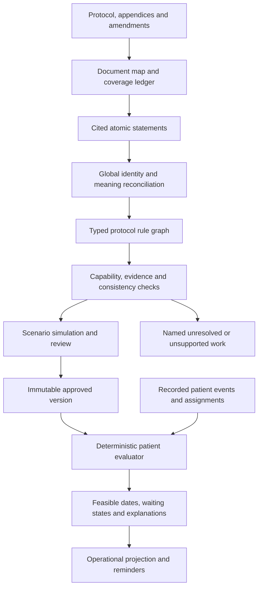

# Adaptive protocol interpretation and scheduling

Design proposal, 30 September 2026. This is a proposed evolution of MTB's current
working tree, not a claim that the capabilities below are implemented or tested.

Companions: [product requirements](adaptive-protocol-brain-requirements.md) and
[Claude Code implementation prompt](adaptive-protocol-brain-claude-prompt.md).
The requirements define product acceptance; this document defines the proposed
architecture and implementation contracts. Names below are proposed unless an
existing code location is explicitly identified. Reinspect the working tree before
implementation because other work may have advanced it.

## Decision

Build an evidence-backed protocol compiler and a deterministic, composable rule
runtime. AI proposes interpretations; approved rules govern patient schedules.
Represent a protocol as related activities, constraints, decisions and state
transitions. A visit table is one view of that model.

The objective is broad coverage with explicit limits, not a promise of perfect
automation for every future protocol. For each relevant statement the system
must either execute its approved meaning, wait for a named input, route a named
decision to review, or declare an unsupported capability. An omitted statement
must never be treated as a supported one.

## Required user-facing output: Visit Schedule

The user's supplied mobile screenshot establishes the intended product output.
Uploading a protocol must lead to a readable draft Visit Schedule with extraction
status, row counts, review filters, visit names, timing, windows and editing.
The rule model supplies this screen through a deterministic presentation layer.

```text
Upload protocol -> interpret and validate -> draft Visit Schedule
                -> resolve review questions -> approve version
                -> apply patient facts -> patient calendar
```

Keep the screenshot's compact table and expandable detail pattern. Label the time
column `Timing` so it can faithfully display days, months, cycles, relative events
and conditional timing. Each offset names its reference in the row or a clearly
applicable table heading. The following labels illustrate formatting only; they
are not extracted findings or approved interpretations of the pictured trial:

| Visit name | Timing | Window |
| --- | --- | --- |
| On-study visit | Day 1 from the stated origin | Not stated |
| Month 3 contact | 3 calendar months after the stated anchor | As stated in protocol |
| Cycle assessment | Day 1 of each applicable cycle | As stated in protocol |
| Relapse assessment | At confirmed relapse | As stated in protocol |
| Safety follow-up | 2 weeks after actual final visit | As stated in protocol |
| Assessment needing clarification | Timing needs review | Unresolved |

Do not infer these timings from the screenshot. Its labels and values require
checking against the source protocol. In particular, do not automatically convert
calendar months to 30-day multiples, or replace an actual-event dependency with
an absolute baseline offset. A displayed range can be the timing requirement
itself; do not invent a midpoint and plus/minus window.

Each expandable row exposes assessments, applicable arms/cohorts, reference event,
recurrence/termination, additional constraints, source passages and specific
review questions. Display complex restrictions faithfully in a short summary and
the full details. Arm/phase filters and expandable recurring groups keep the
table manageable without discarding obligations.

Use a proposed presentation contract such as:

```text
ScheduleReviewView {
  draft_version_id, extraction_status, source_coverage_status,
  summary { displayed_rows, pending_rows, ready_rows, blocking_issues },
  groups[],
  rows[] {
    id, rule_refs[], visit_name, timing_summary, window_summary,
    applicability_summary, review_status, issue_refs[],
    details { activities[], anchors[], recurrence, constraints[], evidence[] }
  },
  shared_review_questions[], can_approve
}
```

This is a proposed response contract, not an implemented API. Derive its labels
and statuses from canonical rules and validation results. Store semantic edits
on the underlying draft rules, then revalidate and regenerate the view; changing
display text alone must never change scheduling behavior.

Count displayed rows separately from generated patient occurrences. An open-ended
series cannot truthfully be summarized as a fixed total number of future visits.
Define Pending as rows with unresolved review requirements and Ready as rows
eligible for approval; Ready does not itself mean approved. Show document-level
coverage issues even when they cannot be attached to a visit row.

Use `Questions to resolve` for missing or ambiguous meaning instead of presenting
guessed clinical values as extraction assumptions. Missing windows display
`Not stated`; unresolved windows display `Needs review`. They are distinct.
Add Visit, edit and export act on this versioned draft. Approval is blocked by
material unresolved issues; later patient data supplies actual calendar dates.

The inspected `SimpleScheduleTable.tsx` already uses a Timing column and expandable
details. Extend this presentation path and `presentation.ts` as implementation
proceeds, subject to the existing protected-route and migration boundaries.

## What the inspected code already provides

The checkout has substantial uncommitted work. The current `runner.py` implements
a reader/compiler pipeline, although the older handoff and AGENTS context describe
extraction as removed. Preserve this work and evolve it incrementally.

| Inspected code | Useful foundation or limitation |
| --- | --- |
| `backend/app/extraction/runner.py` | Reader -> facts -> deterministic compiler already exists. |
| `backend/app/extraction/facts.py` | Cited facts and explicit unresolved patterns exist. The timing patterns are a closed list; unknown model fields are ignored. |
| `backend/app/extraction/reader.py` | Keyword-based page selection is capped. Unmatched quotes and some invalid items become nonblocking issues. Conflict labels are scoped to individual batches. |
| `backend/app/extraction/compiler.py`, `_build_group` | Different timing signatures are treated as conflicting; an uncompiled statement can become a nonblocking warning while a compiled reading is used. It needs to distinguish conjunction, alternatives, duplicates and genuine contradictions. |
| `backend/app/domain/schedule/timing.py` | Typed relative timing, activity references and actual/planned anchor acceptance exist. General intersections across independent timing references are absent from the timing union. |
| `backend/app/domain/schedule/models.py` | Cycles, phased recurrence, conditions, scopes and separate actual/planned anchors exist. Recurrence currently exposes interval-based repetition. |
| `backend/app/domain/schedule/condition.py` | AND/OR/NOT and TRUE/FALSE/UNKNOWN evaluation already exist. Reuse them. |
| `frontend/app/(app)/clinical/add-patient.tsx` | Additional anchors use a known-date field with an instruction to leave blank until occurrence; this UI does not offer an explicit planned/actual choice. |
| `backend/app/services/parity_service.py` | An explicit per-trial read-mode gate exists. Preserve this deployment boundary. |

These are static code observations. No real protocol extraction or runtime tests
were performed for this proposal. The pasted assessment is a scenario source;
its clinical interpretations and section references have not been checked against
the original PDF, which was not supplied.

## Separate five different problems

| Problem | Correct response |
| --- | --- |
| Extraction omission or unreadable source | Retrieve the missing section, improve document reading, or request source review. |
| Meaning unclear or contradictory | Preserve alternatives and obtain an authorized interpretation; do not invent a rule. |
| Meaning clear but unsupported | Report the exact missing operator and affected activities; implement and validate it. |
| Meaning supported but patient input missing | Wait for the anchor, assignment or observation; name what is needed. |
| Meaning supported but dates infeasible | Explain the incompatible constraints and route to the protocol's exception process. |

Review does not fix an incapable runtime. A human decision cannot turn an
unsupported weekday recurrence into an executable rule merely by approving it.

## Proposed flow



### 1. Read the document with explicit coverage

Inventory every page, table, footnote, appendix and referenced section. Preserve
document hash, version, page, source span and table coordinates or image region.
Perform a whole-document discovery pass; use targeted detailed reading afterward.
Keyword ranking can prioritize work but cannot prove omitted pages irrelevant.

Follow references recursively with visited-reference tracking and explicit limits.
If a required appendix is absent, a scan cannot be read, or a processing budget is
exhausted, mark the affected coverage incomplete. Resume from checkpoints instead
of silently declaring the extraction complete.

Maintain two linked ledgers:

- Source coverage: every source unit is inspected, unresolved, unreadable or
  excluded with a recorded rationale.
- Statement disposition: every discovered requirement is compiled, duplicate of
  another cited requirement, pending interpretation, unsupported, or outside the
  selected product scope with an owner and explanation.

Discovery can itself miss statements. These ledgers make omissions inspectable;
they do not mathematically prove that an AI found everything. Independent source
review and held-out protocol evaluation remain necessary.

Keep original model responses and invalid items for diagnosis. At the normalized
compiler boundary, reject unknown semantic fields rather than silently discarding
them. Formatting repairs may normalize units; they must not supply missing meaning.

### 2. Reconcile meaning across the whole protocol

Create identities using protocol version, activity, epoch, arm/cohort, intervention
and occurrence context. Matching the word "CT" is insufficient to merge baseline,
response and relapse imaging.

Relate statements explicitly as:

- `AND`: two restrictions both apply to the same occurrence.
- `OR`: the protocol permits alternatives, with a decision rule if needed.
- `DUPLICATE`: two sources express the same requirement.
- `EXCEPTION_TO`: one rule modifies another in a stated circumstance.
- `SUPERSEDES`: an authorized amendment replaces a particular rule.
- `CONFLICTS_WITH`: competing interpretations cannot be resolved from the source.

Reconcile across extraction batches. Do not depend on each batch discovering a
conflict it cannot see. Never assume tables always outrank prose or vice versa.
Store a reviewer's resolution with its source, authority, reason and version.

### 3. Use a small language of composable rules

Extend the current typed models; do not create a separate replacement engine.

| Primitive | Meaning |
| --- | --- |
| Activity and occurrence | What must happen, independently of how it is grouped into a visit. |
| Anchor reference | Which event, which occurrence, start/end boundary, and whether a planned value is allowed. |
| Temporal constraint | Before/after, range, minimum/maximum spacing, equality and intersection of constraints. |
| Recurrence | Interval, weekdays, cycle days, phases, count and termination. |
| Predicate | Nested applicability and observation conditions with UNKNOWN preserved. |
| Decision | Explicit branch selection, source and effective time. |
| Transition | Change an intervention, pathway, patient, site or trial state. |
| Obligation | Required/recommended/optional and explicit exceptions. |
| Evidence and version | Why each rule exists and when it applies. |

A useful normalized rule contract is:

```text
Rule {
  id, protocol_version, schema_version,
  subject, scope, occurrence_selector,
  applicability, obligation,
  timing_constraints[], recurrence?, transition?,
  dependency_policy?, exception_links[],
  evidence_links[], interpretation_status
}
```

This is a proposed contract, not a schema accepted by the current API. Each nested
operator needs a typed definition, validation and an explicit evaluator. Arbitrary
Python or model-generated executable expressions are not an extension mechanism.

Keep the rule graph in existing persistence initially. A graph-shaped domain does
not require a graph database or multiple new services.

### 4. Calculate feasible times before choosing appointments

For the PET example, if both protocol statements are confirmed to apply:

```text
PET >= all_therapy_end + 12 weeks
PET <= all_therapy_end + 16 weeks
PET >= RT_end + 12 weeks

earliest = max(all_therapy_end + 12 weeks, RT_end + 12 weeks)
latest   = all_therapy_end + 16 weeks
```

Return the interval plus the source of each bound. If earliest exceeds latest,
return an infeasible result with the conflicting rule IDs. If an actual anchor
is missing, retain any known bounds but mark the result incomplete; do not make
it operationally ready. No claim that one restriction "always wins" is needed.

Start with interval intersection and dependency propagation. Add a general solver
only for constraints that justify it. Calendar months, weekdays and named
occurrences require explicit semantics; a solver does not supply those meanings.

AND intersects feasible sets. OR may produce disjoint intervals; do not flatten
them into one larger interval that permits forbidden dates. Repeated occurrences
need identities and selectors so rules refer to the correct dose or cycle.

Keep protocol feasibility separate from appointment availability. A scheduler can
choose an available slot inside the permitted set but cannot move its boundaries.
Expose target date, permitted set and booked date as distinct values.

### 5. Model treatment and follow-up as concurrent processes

Represent each intervention and follow-up pathway with its own state. A recorded
decision can pause drug A, continue drug B, stop radiotherapy, and preserve survival
follow-up. Withdrawal from treatment, withdrawal of consent and end of follow-up
must be distinguishable.

For each transition store trigger, target, effective time, evidence, recording
authority and downstream effect. A hold also needs an explicit resume policy:
retain the nominal grid, shift by elapsed hold time, restart from actual resumption,
or wait for a decision. Do not infer one from the word "resume."

Dose calculation is a separate capability with typed quantities, units, inputs and
validated decision tables. Scheduling should consume approved administration and
hold/stop decisions even before automated dose calculation exists. Retain dose
statements and identify their disposition instead of dropping them as extraction
noise. Full dose automation requires its own implementation and validation.

### 6. Keep forecasts separate from observed events

Represent patient facts with value, precision, planned/actual status, occurrence
identity, effective time, recording time, source and supersession link. Never
promote a forecast to actual merely because its calendar date has passed.

Use planned dates for explicitly allowed planning projections. Actual-only rules
wait for recorded occurrence. Recompute affected future obligations after a new
event or correction, preserving completed history and recalculating expected dates
for deviation analysis. Use idempotent event processing and stable occurrence IDs.

Evaluate from pinned protocol, interpreter and calendar versions, patient facts,
explicit as-of time and a finite projection horizon. Open-ended follow-up must not
become an invented clinical maximum when the projection horizon is reached.

## How the supplied cases map to the design

| Case | Representation and required behavior |
| --- | --- |
| Tests within 4/6 weeks before entry | Backward interval from a named entry anchor; keep registration distinct until equivalence is established. |
| Pregnancy testing for a subgroup | Applicability predicate plus timing constraint; missing subgroup information remains UNKNOWN. |
| Start treatment within four weeks | Deadline obligation relative to registration; scheduled start and actual start remain distinct. |
| Arm A versus Arm B | Versioned assignment and arm-scoped activities/cycle plans. Unknown assignment blocks affected activities. |
| Weekly chemotherapy x6 | Recurrence with an explicit occurrence count and start inclusion. |
| Consolidation week 10 versus after concurrent therapy | Competing anchor interpretations unless the source explicitly makes them joint constraints; simulate delay to reveal divergence. |
| Two 21-day cycles, Days 1/8/15 | Cycle recurrence and selected cycle days, scoped by intervention and arm. |
| Late cycles and toxicity holds | Explicit dependency and resume policies; preserve uncertainty when unstated. |
| End of concurrent/consolidation/all therapy | Named component milestones. Derived completion requires a defined component set and stop/completion policy. |
| FEV1 after consolidation | Separate offsets from the appropriate actual milestone. |
| CT within six weeks, then changing cadence | Initial interval plus phased recurrence; first repeat anchor and boundary ownership must be resolved. Preserve "recommended" requiredness. |
| PET with two minimum delays | Intersect all applicable constraints, retaining both references. |
| Follow-up changing frequency and then lifelong | Phased recurrence with explicit boundary ownership and bounded materialization. |
| Repeat until toxicity resolves | Condition episode with onset/resolution, recurrence and explicit endpoint inclusion. |
| Tests at relapse | Triggered obligations linked to a specific relapse episode; repeated relapse needs separate episode IDs. |
| Grade-based hold/resume | Confirmed observations and intervention-specific transitions; record rather than infer a clinical decision where required. |
| Stop treatment but continue follow-up | Separate process states and explicit action targets. |
| Accrual suspension/DSMC review | Trial-level workflow with patient-impact links only where explicitly stated. |
| Premedication before dose | Intra-day temporal dependency. Forecast from scheduled dose when permitted; compliance uses recorded administration times. |
| Daily RT five weekdays, 30 fractions | Calendar-filtered recurrence plus fraction identities. Distinguish 30 planned slots from 30 delivered fractions; missed-day replacement and holidays need explicit policies. |
| QoL with contradictory anchors | Preserve each cited interpretation; show resulting timelines and require an authorized resolution. |
| "Approximately 30 days" | Preserve approximate precision; obtain an operational window before automated due/overdue enforcement. |
| Dose reductions or stopping one drug | Separate dose/decision module plus component-specific transitions. |

A radiotherapy block may be an appropriate display, but it does not enforce
fraction-level obligations. Do not present that workaround as equivalent coverage.

## Handling additional trial designs

Compose the same building blocks for crossover periods, washouts, nested cohorts,
optional substudies, surgery pathways and repeated event-triggered assessments.
Assignments and decisions need history and effective times, not only a current arm.

Adaptive allocation, escalation and cohort opening may depend on an external
randomization/statistical system or committee. Consume an authorized decision
event and apply its approved schedule consequences. Supporting its schedule does
not imply implementing the statistical design or independently choosing a dose.

For a genuinely new operator:

1. Preserve the source and emit a structured capability gap.
2. Identify the affected rule and transitive downstream obligations.
3. Specify the operator's types, semantics, missing-data behavior and boundaries.
4. Implement a versioned deterministic handler and independent test cases.
5. Recompile, simulate and review before activation.

Reviewed examples can improve prompts, retrieval and reusable rule templates.
Trial-specific interpretations must retain their scope; a past reviewer's choice
must not silently become the default for a different protocol.

## Review and activation contract

Keep separate dimensions rather than overloading one status:

- Interpretation: resolved, ambiguous or conflicting.
- Capability: supported or unsupported.
- Patient readiness: ready, waiting for anchor/input, or inapplicable.
- Feasibility: feasible, incomplete or infeasible.
- Execution: planned, booked, completed, missed, paused or cancelled.

Show the reviewer source excerpts, proposed meaning, affected activities and a
timeline under each plausible interpretation. Ask one question per shared issue;
one unresolved anchor should not generate dozens of duplicate review tasks.

Activate only when required source coverage is reviewed, material statements have
dispositions, required operators are supported, and evidence and interpretation
issues are resolved. A missing actual date for a future event is normal runtime
waiting, not automatically a reason to reject the protocol definition.

Initially retain the existing whole-version approval gate. Partial activation
requires separately implemented dependency-closure checks proving unresolved rules
cannot affect the activated subset. A warning acknowledgement cannot waive a
potentially omitted timing restriction. Reminders require an eligible execution
state and sufficiently resolved operational timing.

## Verification strategy

Build independent answer keys from original protocols with qualified review.
The pasted assessment supplies candidate scenarios, not a validated gold standard.
Separate extraction fidelity, compiler meaning, evaluator behavior and UI/API
preservation; passing evaluator tests does not prove the PDF reader finds rules.

Use a diverse held-out set: oncology, surgery, crossover, device, observational,
adaptive/platform, pediatric and substudy protocols; include scans, tables split
across pages, footnotes and amendments. Keep training examples separate.

Test rule compositions and changes to patient history, especially:

- Added restrictions never widen an AND-constrained feasible set.
- Planned anchors never satisfy actual-only requirements.
- Missing applicability data never becomes FALSE by default.
- A Friday start, holiday, missed fraction and toxicity hold interact correctly.
- Delayed cycles diverge under fixed-grid versus actual-start policies.
- Reordered extraction batches preserve semantic results.
- Duplicate events do not duplicate obligations.
- Anchor corrections preserve actual history and expose future impact.
- Disjoint alternatives remain disjoint; impossible intersections remain blocked.
- Amendments preserve completed occurrences and require explicit patient migration.
- Retrying projection after partial failure is idempotent.

Report missed/incorrect obligations, unsupported and unresolved rates, evidence
validity, incorrect ready-to-execute decisions and reviewer effort by rule family.
Set release thresholds before evaluation; a single overall accuracy percentage
can hide a severe failure in an uncommon rule family.

## Implementation order for MTB

| Stage | Concrete deliverable | Exit evidence |
| --- | --- | --- |
| 1. Prevent apparent completeness | Statement disposition ledger; material uncompiled statements and invalid evidence block affected approval; retain invalid model items. | Fixtures show that a valid primary statement cannot conceal an additional unsupported restriction. |
| 2. Compose time constraints | Typed constraint sets, semantic relation links, global reconciliation, interval/set evaluation and conflict explanations. | PET conjunction, true QoL conflict, missing anchors and infeasible intersections produce different correct outcomes. |
| 3. Represent calendars and event certainty | Weekday recurrence, explicit holiday/missed-occurrence policies; planned/actual controls through UI, API, persistence and projection. | Fraction scenarios and patient enrollment preserve occurrence count semantics and actual-only waiting. |
| 4. Generalize process state | Intervention-specific transitions, scoped decisions, assignment history and dependency-driven recalculation. | Stop one drug, continue another and retain follow-up under holds, corrections and amendments. |
| 5. Expand extraction coverage | Whole-document inventory, reference traversal, cross-batch reconciliation and coverage review. | Held-out full-document evaluation finds restrictions outside the SoA table. |
| 6. Controlled rollout | Version migration, shadow evaluation, full product-path verification and per-trial cutover through the existing gate. | Legacy parity where semantics match, explicitly adjudicated intended differences, and rollback verification. |

Begin the held-out corpus and source coverage instrumentation in stage 1; stage 5
expands the reading strategy. Dose automation and statistical decision engines are
separate capability tracks, not implied deliverables of these six stages.

Every stage must cover extraction schema, compiler, validator, evaluator,
persistence, API, review UI, patient display and reminders as applicable. A rule
supported only in the domain model is not supported by the product.

Do not flip `UCTSM_AUTHORITATIVE` or migrate the protected legacy schedule screens
as part of this design. Use the existing per-trial transition mechanism and verify
its current behavior before rollout. Preserve Mongo operational compatibility and
existing version pinning, impact previews and protected history.

## Implementation specification: composable protocol language

The protocol language is a versioned, typed abstract syntax tree (AST). JSON is a
transport encoding of that tree. The language is the reusable execution boundary;
the reader's extraction patterns are an input convenience, not a permanent limit
on which combinations the system can express.

Use a capability registry declaring each operator's schema version, accepted input
types, output type, validator, evaluator, dependency resolver and presentation
formatter. Capability checks traverse nested expressions. A missing nested handler
makes its enclosing rule unsupported. No catch-all handler may return an empty
successful result for an unknown operator.

### Language families

```text
TemporalValue :=
    LiteralDate(value, precision)
  | Reference(entity_id, occurrence_selector, START|END, ACTUAL|PLANNED_OR_ACTUAL)
  | Shift(TemporalValue, signed_duration, calendar_policy_ref?)

Constraint :=
    LowerBound(TemporalValue, inclusive)
  | UpperBound(TemporalValue, inclusive)
  | At(TemporalValue)
  | All(Constraint...)
  | Any(Constraint...)

Predicate :=
    Comparison(typed_operand, operator, typed_operand)
  | Membership(typed_operand, values)
  | All(Predicate...) | Any(Predicate...) | Not(Predicate)

Recurrence :=
    Interval(reference, amount, start_policy, termination)
  | Calendar(reference, weekdays, interval_weeks, calendar_policy_ref, termination)
  | Cycle(plan_ref, day_selectors, cycle_selectors)
  | Phased(reference, ordered_segments, boundary_policies, termination)

Action :=
    Require(activity_ref)
  | Transition(target_ref, next_state, effective_time, consequence_policy_ref)
  | RequestDecision(decision_type, authority_ref)

Rule :=
    Scope(subject_ref, applicability, trigger?, action,
          constraints?, recurrence?, obligation, evidence, version)
```

Each family has its own discriminator; `All(Constraint)` and `All(Predicate)` are
different typed nodes. Implement only declared, tested operators and advertise
their availability. Keep unknown source constructs as unsupported requirements,
never squeeze them into an approximately similar executable type.

`Any(Constraint)` means permitted temporal alternatives. Choosing a treatment arm
requires a separate decision/assignment fact; it cannot be implemented by selecting
whichever temporal branch happens to be easiest. `Not(Predicate)` uses three-valued
logic. Temporal negation is not automatically supported merely because predicate
negation exists; explicit excluded intervals require their own typed semantics.

An exact synthetic representation of a two-anchor timing rule can look like:

```json
{
  "schema_version": "proposed-v1",
  "rule_id": "scan-followup",
  "subject_ref": "patient",
  "action": {"type": "REQUIRE", "activity_ref": "scan"},
  "constraints": {
    "type": "ALL",
    "items": [
      {"type": "LOWER_BOUND", "inclusive": true,
       "value": {"type": "SHIFT", "reference": {
         "type": "ANCHOR", "code": "ALL_THERAPY_END", "accepts": "ACTUAL"},
         "amount": {"value": 12, "unit": "WEEK"}}},
      {"type": "UPPER_BOUND", "inclusive": true,
       "value": {"type": "SHIFT", "reference": {
         "type": "ANCHOR", "code": "ALL_THERAPY_END", "accepts": "ACTUAL"},
         "amount": {"value": 16, "unit": "WEEK"}}},
      {"type": "LOWER_BOUND", "inclusive": true,
       "value": {"type": "SHIFT", "reference": {
         "type": "ANCHOR", "code": "RT_END", "accepts": "ACTUAL"},
         "amount": {"value": 12, "unit": "WEEK"}}}
    ]
  },
  "evidence_refs": ["synthetic-statement-1", "synthetic-statement-2"]
}
```

This example explicitly supplies inclusive bounds for testing. It is not a
clinical interpretation of the unavailable sample PDF. Validate all references,
including evidence references, before accepting any corresponding real payload.

### Temporal semantics

- Date-only values and timestamp values remain distinct. A date does not establish
  an infusion time; intra-day rules requiring time precision wait for that input.
- Preserve calendar amounts. Months and years use an explicit versioned calendar
  policy; do not convert them to 30 or 365 days. Distinguish recurrence measured
  repeatedly from an origin from recurrence measured from each actual prior event.
- An elapsed hour and a local calendar day have different semantics around DST.
  Persist the applicable time zone and amount semantics. Use aware timestamps
  internally where time-of-day matters; preserve the local-date meaning of visits.
- Month-end rollover, holiday calendars and nearest-business-day adjustments are
  material policies. Reuse an already approved explicit policy or require a
  decision when the protocol leaves material behavior unspecified. Do not inherit
  a date library's incidental behavior as a hidden clinical rule.
- A timing range is an allowed set. A nominal target and an allowed window are
  separate concepts; a range without a stated target has no invented midpoint.
- Reference occurrence selectors must identify a concrete cycle, activity or
  condition episode. `LAST` in an unfinished series can be unknown; the last event
  observed so far is not necessarily the final event of therapy.
- Derived completion milestones require explicit definitions for all required
  components, including stopped, omitted and never-started components.

### Semantic identity and graph validity

Use stable entity IDs independent of display labels and model wording. Initial
proposed identity includes protocol version, phase, intervention, applicability
scope and occurrence role. An identity reconciliation decision is evidence-backed;
uncertain merges become review tasks. Renaming a row must not create a new event.

Build dependency edges from typed references. Reject unresolvable same-occurrence
cycles. Recurrence and state machines may loop through successive occurrences;
they must have an occurrence-advancement rule and materialization bound. Do not
reject a valid recurring process merely because its template graph contains a loop.

Normalize equivalent facts before semantic comparison. Do not require equivalent
source wording to produce byte-identical JSON; compare normalized meaning. Preserve
provenance when deduplicating. Deterministic compilation may produce distinct audit
timestamps while retaining identical semantic hashes and executable results.

## Implementation specification: interpretation and validation pipeline

### Durable artifacts

Persist or reference these artifacts under an extraction run and source version:

1. Document manifest and page/source-unit inventory.
2. Stage inputs, versions, status, usage and resumable checkpoints.
3. Raw model responses in controlled artifact storage, not ordinary log lines.
4. Parsed source statements and rejected items.
5. Evidence anchors and verification results.
6. Entity identities and semantic relations.
7. Normalized executable model and capability report.
8. Validation issues, simulated scenarios and review questions.
9. Immutable approval artifact and semantic hash when approved.

Use existing extraction persistence where possible. Introduce new tables or JSON
fields only where needed for durability, queryability or concurrency. Existing
short-lived preview caches are not the sole durable record of an approved model.

Suggested records:

```text
SourceUnit(id, document_hash, page, region_or_span, text_status,
           coverage_state, rationale, referenced_unit_ids)
Statement(id, source_refs, raw_text, proposed_meaning, identity_context,
          disposition, rule_refs, issue_refs)
EvidenceLink(id, source_unit, span_or_region, quote, verification_state,
             verified_by, source_hash)
InterpretationDecision(id, subject_ids, alternatives, resolution,
                       authority, reason, evidence_refs, revision)
CapabilityIssue(operator, operator_version, rule_refs, affected_refs, evidence_refs)
```

Evidence verification states distinguish text-matched, image-verified, unresolved
and rejected. A text match establishes that words exist, not that the proposed
interpretation follows from them. Image evidence needs a verified page/region;
scanned pages cannot bypass evidence checks simply because quote matching fails.

### Bounded reasoning loop

```text
inventory document and references
discover candidate requirements and source coverage gaps
read evidence for candidate requirements
reconcile entities and relations across all batches
normalize proposed rules
validate evidence, semantics, capabilities and dependencies
while recoverable evidence gaps remain and configured budget remains:
    retrieve targeted source context
    propose a revision with provenance
    repeat affected validation and reconciliation
persist complete draft or explicit incomplete draft with issues
```

Every revision records why it changed. A model's claim that an issue is fixed is
not the validator's decision. Repeated model agreement is not proof of clinical
correctness. Simulation can reveal conflicting interpretations but cannot choose
the intended interpretation merely because one yields a feasible schedule.

### Gate sequence

1. **Structural:** schema, units, known operators, valid IDs and references.
2. **Evidence:** cited sources exist; material semantic fields have traceable support.
3. **Coverage:** required source units reviewed and statements accounted for.
4. **Semantic:** combinations, scope, boundaries and dependencies are well-defined.
5. **Capability:** all required nested operators are available in the pinned runtime.
6. **Simulation:** applicable acceptance probes and protocol-specific invariants pass.
7. **Review:** authorized resolutions are current and required approvals recorded.

Do not collapse these into a single confidence score. A high model confidence
cannot waive a failed gate. A legitimate excluded non-scheduling section may be
accounted for without an executable scheduling rule, provided its disposition is
reviewable and does not conceal a dependency.

## Implementation specification: deterministic runtime

Input is the approved model plus patient/assignment/decision facts, applicable
policy versions, as-of time and projection horizon. Runtime execution makes no LLM
call. The following is a proposed evaluator sequence:

```text
verify approved bundle and supported semantic versions
resolve effective patient and scoped process state
evaluate applicability and activation predicates using three-valued logic
expand eligible recurrence templates within horizon and resource bounds
resolve occurrence-specific anchors without promoting planned facts to actual
evaluate constraint sets and propagate dependencies
produce outcomes with proof/explanation traces
compare with existing logical occurrences
preserve protected actual history and propose future changes
persist/reconcile through existing workflow boundaries
```

An evaluation result should carry:

```text
OccurrenceResult {
  logical_occurrence_id, rule_refs, activity_refs,
  applicability, activation, execution_status,
  feasibility: FEASIBLE|INCOMPLETE|INFEASIBLE,
  feasible_intervals[{lower, upper, lower_inclusive, upper_inclusive}],
  nominal_target?, booked_time?, actual_time?,
  input_fact_refs[], missing_inputs[], issue_refs[], explanation
}
```

Interval endpoints may be unbounded. Unbounded does not mean a date is missing;
distinguish a legitimately one-sided requirement from an unresolved endpoint.
An exact feasible set can still lack a chosen appointment. Reminder policies must
use the type of obligation and operational date they actually require; they must
not invent a nominal date from a range.

`ALL` intersects feasible sets and propagates missing dependencies. Known
contradictions can establish infeasibility even if other inputs are missing.
`ANY` preserves alternative sets and uncertainty about unresolved alternatives;
it does not expand known alternatives into a convex hull. Normalize sets without
losing excluded boundaries or their source-rule explanations.

Use stable recurrence keys based on template identity and defined occurrence
identity (cycle/episode/ordinal), never on the current computed date alone. A
reschedule keeps the key. A second relapse has a different episode key. Corrected
actual dates must not reorder doses into different cycle identities implicitly.

### Event processing and concurrency

Record events at their authoritative existing write service; do not create a
competing patient-truth store. Preserve effective and recorded times plus
supersession where supported, extending those records when needed. Only confirmed
facts or authorized decision events may enact the corresponding consequences.

Record canonical changes and a durable projection intent in one database
transaction where they share a store. Use the existing durable job/outbox mechanism
if present; otherwise add one at the relevant boundary. SQL and Mongo do not share
a transaction here: use idempotent projection with stable keys, retry tracking and
reconciliation, not an assertion of cross-store atomicity. Link audit records with
a correlation ID without pretending the two existing logs are already unified.

Approvals, edits and patient-impact confirmations must check expected revision or
input fingerprint. Revalidate within the authoritative commit path so concurrent
edits cannot approve an earlier draft accidentally. Retrying an operation with the
same idempotency key and a different body must fail explicitly.

## Implementation specification: API and UI integration

Extend the existing extraction, draft import, review and patient schedule routes.
Inspect route contracts before choosing new paths. In particular, preserve the
current `/protocols/extract`, extraction consume, UCTSM draft and queued extraction
entry points unless a compatibility adapter is provided. Avoid a second parallel
upload pipeline just for the new screen.

Logical operations required (route names to follow repository conventions):

| Operation | Contract |
| --- | --- |
| Start extraction | Source reference/hash, idempotency key, authorized trial/protocol context; returns durable run identity and current status. |
| Read progress/result | Returns stage, resumable/incomplete status, coverage, issue summary and draft identity when available. |
| Read review view | Returns version/revision, rows, groups, evidence links, shared questions and backend approval eligibility. |
| Edit draft | Typed semantic patch with expected revision and rationale; returns revalidated draft and affected-row changes. |
| Resolve interpretation | Question/alternative IDs, authorized resolution and reason with expected revision. |
| Approve version | Expected revision/hash; backend reruns gates and creates immutable executable version. |
| Export | Requested draft/version and format; includes full details or an explicit linked detail appendix. |
| Record patient fact | Typed planned/actual fact, occurrence identity, effective time and source; uses existing authorization and impact flow. |
| Preview/confirm impact | Existing fingerprinted workflow extended to new operators and occurrence states. |

Server responses need structured issue codes, affected IDs, missing inputs, retry
eligibility and human-readable explanation. Follow existing error conventions;
distinguish stale revision, invalid semantics, missing provider and transient
provider failure. Never return an empty successful schedule on extraction failure.

Keep canonical rules authoritative. The API/client presentation path derives
display strings from typed rules; there must be one tested formatting definition
per operator, with explicit handling of unsupported summaries. A formatter may
show a compact summary plus "additional constraints" but cannot conceal the
presence of a material restriction.

Reuse `ProtocolScheduleRow`, `presentation.ts`, `SimpleScheduleTable.tsx` and the
review screens where their contracts fit. Separate protocol review status from
patient execution status. Aggregate review counts over unique row IDs; shared
questions and source-level issues have separate counts. A row with no unresolved
issues can be Ready while the draft remains blocked by document coverage.

Export implementation should reuse the existing format if it preserves meaning.
If a flat export cannot carry all rules, include a detail appendix or structured
sidecar and label the summary. For a new structured export use versioned JSON;
human-readable exports need the draft/approved state, source version and creation
time. Do not introduce a heavy PDF dependency solely to mimic the download icon.

## Implementation specification: compatibility, delivery and tests

### Compatibility strategy

Additive types and adapters must preserve the meaning of existing approved
versions. A loader may adapt a legacy single-reference rule to a one-item constraint
set when equivalence is demonstrated. It must not reinterpret missing old fields
as newly invented clinical policy. Store schema/semantic versions and preserve
the prior evaluator behavior where migration is not proven equivalent.

Apply database changes through repository migrations, accounting for existing
uncommitted migrations and branch heads. Test serialization round trips and fresh
and existing database upgrade paths for changed persistence. Do not renumber or
overwrite someone else's migration to obtain a clean sequence.

Feature rollout begins in drafts and shadow patient evaluation. No new operator
is product-complete until persistence, API, presentation, operational projection
and notification suppression can carry its semantics. Existing parity gates are
preserved. Intended differences need explicit adjudication through the supported
workflow; do not weaken the gate to force a cutover.

### Work packages and traceability

| Package | Requirements | Expected integration points |
| --- | --- | --- |
| WP0: current-state audit and baseline | NF-08, all traceability | AGENTS, handoff, git status/diff, existing tests and route contracts. |
| WP1: accountable extraction artifacts | IN-01..06, IR-01/05/06, RV-01 | reader, facts, contracts, runner, extraction service, persistence, review issue display. |
| WP2: composable semantics | IR-02..04, RL-01..06/12/13 | normalized rules, compiler, timing, validator, evaluator, presentation. |
| WP3: calendar and scoped process execution | RL-07..11/14, PT-01..04/07 | recurrence, conditional engine, anchor services, enrollment API/UI, projection. |
| WP4: durable review and operational journey | UI-01..12, RV-02..05, PT-05/06 | active upload path, import, review services/UI, exports, impact and reconciliation. |
| WP5: broad coverage and generalization | IN-02..04, IR-03/06, NF-01..09 | reference traversal, independent fixtures, held-out evaluation, fault injection. |

These packages organize delivery; they are not permission to defer basic UI,
persistence or checks until the final package. Land runnable vertical slices and
continue through all in-scope work. If a package exposes a missing prerequisite,
add it to traceability and handle it without claiming the package complete.

### Verification commands and constraints

Use the repository's Python environment from `backend/`; verify dependencies before
running tests. Relevant existing files include `test_extraction_reader.py`,
`test_extraction_compiler.py`, `test_extraction_endpoints.py`,
`test_engine_planned_vs_actual.py`, `test_engine_recurrence_calendar.py`,
`test_engine_cycles.py`, `test_engine_phased_followup.py`, `test_engine_windows.py`,
`test_engine_rule_scope.py`, and the `test_scenario_*.py` modules. File presence is
not proof of passing tests, and the list may change during implementation.

Run narrow meaningful tests for each change, followed by the surviving curated
gate from `MTB_IMPLEMENTATION_HANDOFF.txt` section E and newly affected modules.
Omit the two deleted extraction/footnote files named in AGENTS. Run TestClient
integration modules in separate processes where required by the documented
anyio/starlette teardown issue. Do not substitute a whole-suite plain pytest run.

From `frontend/`, use `npm run test:uctsm` or its relevant `test:uctsm-*` scripts.
There is no generic `npm test`. Full-project TypeScript checking has a documented
memory problem and Expo lint depends on unavailable `yarnpkg`. Use a scoped check
with appropriate project JSX/module options and report limitations accurately;
an unconfigured standalone `tsc` invocation is not evidence of type correctness.
Inspect actual rendered behavior on an available runtime for mobile wrapping,
expansion, review and recovery states. If no renderer is available, identify that
gap rather than claim visual verification from source-only tests.

For new logic, test invariants and independent examples rather than snapshotting
the implementation's own output as the expected truth. Include schema round trips,
backend authorization, stale revisions, replay, partial-write recovery and a
fixture-driven upload-to-review-to-patient journey. Offline fake model clients
must be visibly confined to tests; never return fixture data in the real pipeline.

### Delivery artifacts

Maintain `docs/adaptive-protocol-brain-implementation-status.md` with requirement
traceability, implemented operator versions, commands/results, known limitations,
decisions, changed files and the next concrete unfinished work. Do not replace
the requirements with a falsely optimistic status summary.

At completion provide a reproducible local demonstration using synthetic inputs,
an explanation of the data migrations and configuration changes, and an honest
statement of whether any original protocol was evaluated. Absence of a real PDF
does not block offline implementation, but it blocks claiming measured real-PDF
extraction quality. Runtime deployment and trial cutover are separate from local
implementation completion.

## Standards alignment

CDISC's [Unified Study Definitions Model / Digital Data Flow](https://www.cdisc.org/ddf)
provides a study-definition reference architecture. The official
[DDF-RA repository](https://github.com/cdisc-org/DDF-RA) publishes its logical model,
API definition, implementation guide and terminology. Align names and exchange
boundaries with this vocabulary where appropriate, pinning a chosen standard
version and documenting mappings and extensions.

This proposal's inference is to use USDM as an interoperability reference while
retaining explicit MTB runtime semantics. Standards alignment alone does not
establish extraction accuracy, executable scheduling correctness or clinical
validation.
