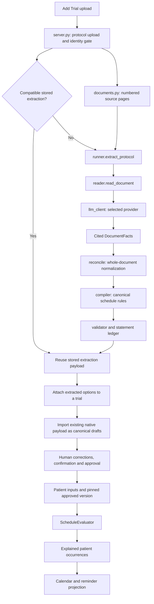

# How protocol extraction and schedule formation work

This guide explains the current local source as inspected on **22 October 2026**. It covers every file in the earlier 21-file reading list, then adds the service implementations and API boundaries needed to trace the actual calls. It is a code-reading guide, not an implementation prompt.

Use these three documents together:

- **This guide:** the meaning of the code, the data it passes and the order in which things happen.
- **[Line-by-line source companion](walkthrough.html):** original source beside static statement explanations. Choose a file, choose a function, search a name or jump to a line. Entire selected files are included, including `server.py`.
- **[File and symbol directory](file-guide.md):** every function/class/type found in the selected files, with line references, source docstrings and additional application notes where supplied.

The source companion is a standalone HTML file: open `walkthrough.html` in a browser. It needs no server or internet connection. It renders one page of lines at a time so the large files remain usable. Its source is a snapshot, not a live editor.

**What “line-by-line” means here:** each physical line has an entry. Python notes are generated from Python's parsed statements and tokens; TypeScript notes use the project's TypeScript parser. A multiline call, model field or expression executes as one statement, so its continuation lines refer back to that statement. Blank lines, comments, docstrings and prompt text are distinguished from executable statements. These annotations explain syntax and data movement; they are not a claim that every business decision has received independent human review or that this snapshot was executed successfully. The explanations below supply the application context that syntax alone cannot establish.

## 1. Understand the five different objects first

| Object | Plain-language meaning | Main definition |
|---|---|---|
| `DocumentPage` | One physical source page, its extracted text and text quality classification. | `extraction/contracts.py` |
| `ScheduleFact` | One source-backed statement such as “follow-up is 28 days after registration.” | `extraction/facts.py` |
| `DocumentFacts` | All metadata, facts, source issues and accountability from one document read. | `extraction/facts.py` |
| `UniversalSchedule` | A reusable protocol definition: visits, activities, timing rules, conditions and evidence. | `domain/schedule/models.py` |
| `EvaluationResult` | The occurrences calculated for one patient's particular inputs and schedule version. | `domain/schedule/models.py` |

There are two transformations. **Extraction/compilation turns a document into reusable rules. Evaluation turns approved rules plus patient facts into patient occurrences.** A visit definition and a dated patient occurrence are different objects. An AI reply is an input to the first transformation, not permission to skip review or a final patient calendar.

No LangGraph orchestration appears in this implementation. The main sequence is ordinary Python calls in `runner.extract_protocol()`.

## 2. The actual upload-to-calendar path



The important detail is that **schedule compilation already happens during full extraction**. The later Add Trial “build” operation imports that computed native payload into canonical version records. It does not need to ask the model to extract the same PDF again.

The upload path can reuse a compatible stored result or completed individual model-call artifacts. These are different reuse levels. Whole-extraction reuse uses identity/content/engine compatibility; per-call reuse uses the exact question, model identity and source pages.

### Two persistence paths coexist

My earlier reading list emphasized the repository-port implementation. That is not the entire HTTP path. In the inspected source:

| Entry path | Adapter/workflow used | Shared logic |
|---|---|---|
| `server.py` Add Trial canonical build | `_import_canonical_schedules_sync()` imports `app.services.native_import`; `_operational_factory()` opens a SQL session. | Native extraction result and canonical schedule model. |
| `app/api/uctsm.py` | SQL-session services exposed through `app.services.schedule_service`. | Domain validator and evaluator. |
| `app/api/uctsm_mongo.py` | Repository-port `application/` workflows on the explicitly configured Mongo patient plane. | Domain validator and evaluator, with plane-specific workflow guards. |

The SQL `schedule_service.py` is now a compatibility facade: its implementations are split across `review_*` and `patient_schedule_*` modules. These are included in the companion. Do not stop reading at a class that only inherits other classes.

This observation does not establish which trial/patient is currently routed where, whether the Mongo plane is configured on a running server, or what has been deployed. Those questions require runtime configuration and stored state. It also does not mean the legacy visit-authoring/read paths have disappeared. Canonical import, approval and a trial's operational read-mode cutover are separate actions.

## 3. `backend/app/extraction/runner.py`: the coordinator

**[Open the source](walkthrough.html#file=0&line=162).** This is the best first file because it shows the sequence without all the internal detail.

The imports tell you the dependencies: document loading, typed contracts, provider clients, artifact storage, reader, reconciler and compiler. Importing them makes their definitions available; it does not mean every imported worker runs on every upload.

`configured_provider()` reads `UCTSM_EXTRACTION_PROVIDER`, normalizes its spelling and checks the corresponding key. Supported branches are Anthropic, Gemini and OpenAI. A key alone does not choose a provider. `engine_available()` reduces that result to a boolean.

`engine_signature()` describes extraction-result compatibility using the selected provider, configured model string and pipeline versions. This is used to decide whether an earlier extraction can be reused. A changed prompt/compiler version can change meaning even for identical PDF bytes, so the document hash alone is insufficient.

`build_client()` creates the selected transport. `_client_for()` currently passes PDF bytes whenever available. Some descriptions still talk about attaching a PDF only for scanned pages; follow this implementation and the scoped client code instead.

`ProtocolExtraction` packages trial metadata, all intermediate facts and the list of schedule-option results.

Read `extract_protocol()` in this exact order:

| Statement | What it does |
|---|---|
| `client = client or _client_for(...)` | Uses an injected client when supplied, as tests do, otherwise builds the configured provider client. |
| `facts = read_document(...)` | Performs model-assisted reading and returns typed facts with coverage and source issues. |
| `facts = reconcile(facts)` | Reconciles the document's facts before any schedule is compiled. |
| `facts.trace.append(...)` | Records document and reconciliation trace metadata; these records describe execution, they do not execute graph nodes. |
| `results = compile_document(...)` | Produces one canonical result per independent schedule option. |
| `for _option, result in results` | Processes each result while deliberately ignoring the option variable in this loop. |
| `result.extraction_trace[:0] = facts.trace` | Inserts reader/reconciliation trace entries at the beginning of the result's trace, preserving the compiler entries afterward. |
| `result.accountability = build_accountability(...)` | Combines source coverage with statement dispositions and reconciliation information. |
| `return ProtocolExtraction(...)` | Returns the metadata, intermediate representation and compiled results together. |

`extract_trial_details()` is the smaller metadata-only route. `extract_schedules()` returns just the results list from the full flow. Neither is a patient-date calculation method.

There are also two background-worker variants. `execute_run()` uses SQL sessions. `execute_run_on_ports()` uses repository ports, leases and heartbeat renewal. Both load the stored document, enforce identity checking and offload blocking extraction calls from the async event loop. The port worker verifies the claim token when completing/failing a run, preventing a worker that lost ownership from overwriting another attempt's state.

## 4. `documents.py`: get usable pages without losing source identity

**[Open the source](walkthrough.html#file=1).** Input is bytes or stored-document location; output is a list of `DocumentPage`s.

`pages_from_pdf()` reads the document page by page, extracts embedded text, checks for suspicious text and preserves one-based physical page numbers. Page 10 stays page 10 even if its text is poor. Evidence references need that identity.

`looks_scrambled()` is a heuristic for broken font maps: it counts sufficiently long Latin-script words and checks the fraction without vowels. It is not a universal language detector or a guarantee that a page is readable. A suspicious page can be treated as image content for native PDF reading.

`pages_from_text()` splits on form-feed characters when present; otherwise the text is one page. `document_text()` adds explicit page markers and a notice for pages with little/no embedded text. Its size check raises an error instead of quietly omitting the remainder.

`load_pages()` reads through the storage abstraction. It returns `(pages, pdf_bytes)` for PDFs and `(pages, None)` for plain text. Keeping the original PDF bytes lets the provider see tables/images that embedded text extraction might miss.

## 5. `contracts.py`: the pipeline boundary

**[Open the source](walkthrough.html#file=2).** This short file defines what the extraction engine accepts and returns.

`DocumentPage.page_number` identifies the physical page. `text` stores extracted content. `layout` allows additional structural information. `text_status` distinguishes usable, sparse and image/empty text.

`ExtractionResult.schedule` can contain a canonical schedule or be `None`. `issues` carries findings. `extraction_trace` describes the stages/results. `accountability` carries source coverage and statement dispositions when available.

Notice what is absent: the extraction contract has no patient's registration date or a generated patient visit calendar. This prevents confusing reusable protocol interpretation with patient evaluation.

## 6. `facts.py`: the AI's structured intermediate language

**[Open the source](walkthrough.html#file=3).** The reader uses these Pydantic models to validate the model's answer before compilation.

`FactModel` preserves extra fields. `unknown_fields()` later finds them so the system can report unrecognized information. Keeping unknown information is different from interpreting it.

The smaller classes describe the parts of a fact:

| Model | Meaning |
|---|---|
| `Duration` | A signed number and an explicitly supported time unit. Its validator accepts known textual spellings. |
| `Citation` | Page, optional section/table and quoted source text, plus the reader's verification status. |
| `ReferenceTo` | The named anchor/event/activity/condition that another timing counts from. |
| `WindowSpec` | Independently stated before/after tolerances. One missing side is not automatically symmetric. |
| `CycleSpec`, `BlockFact` | Cycle location and treatment-block properties. |
| `RepeatSpec`, `RepeatEnd`, `RepeatSegment` | Cadence, termination and phases of recurrence. |
| `OccurrenceSelector` | Explicit activity occurrence restrictions, such as particular cycle numbers. |
| `ConditionSpec`, `Criterion` | A schedule effect and any machine-checkable threshold stated in the source. |
| `FactTiming` | The pattern and parameters of a timing statement. |
| `AppliesTo`, `DimensionFact` | Arm/cohort/part/population applicability. |
| `TrialMetadata`, `ScheduleOption` | Form fields and independent assessment schedules discovered in the document. |
| `ReaderIssue` | A problem encountered while reading, retained for review. |

`ScheduleFact` brings these pieces together. `what` names the obligation; `kind` distinguishes visit/activity/anchor/condition/milestone; `timing`, `window` and `repeat` express schedule meaning. `activities` and `at_visits` connect activities and visits. Dependency, scope and occurrence fields restrict how the obligation is used. `evidence` preserves the source. Conflict/alternative/context fields keep different interpretations distinguishable. Component and process fields describe independently controlled treatment/follow-up branches. `provenance` is populated by deterministic reconciliation.

The field validators mostly normalize formatting, such as recognized enum spellings or a single citation represented as a dictionary. They do not authorize inventing an unstated clinical value. Some schema fields have technical/default values in the current code; distinguish those actual declarations from a general instruction to guess missing protocol meaning.

`DocumentFacts` is the top-level intermediate representation: trial metadata, schedule options, numbering, dimensions, blocks, facts, issues, trace and accountability.

## 7. `reader.py`: the model-assisted reading stage

**[Open `read_document()`](walkthrough.html#file=4&line=1097).** This is where the extraction prompts and reading policy live.

The constants define technical budgets: selected pages, batch size, batch characters, metadata pages, model calls, elapsed time and reference depth. At this snapshot the declared bounds include 400 selected pages, eight pages per batch and 150 model calls, subject to configuration. These are resource controls, not clinical maximum visit counts.

`ReaderLimits.from_env()` defaults to reading all eligible pages within those bounds. Direct `ReaderLimits()` construction has `read_all_pages=False`; the environment construction path overrides it. This distinction matters when comparing tests and the product path. Amendment-history pages are excluded by default so obsolete descriptions of changes do not silently become current rules; the environment option can explicitly alter that behavior.

`plan_pages()` decides which pages are selected, not selected or beyond budget. `_follow_references()` follows sections/appendices under bounded depth/page limits and records gaps. A page's existence in the PDF is not proof it was inspected.

`read_metadata()` asks for the shared overview: trial details, independent schedules, Day 1 statement, dimensions, blocks and known names. Sharing names helps later batches refer to the same anchors/visits.

`batches()` groups selected pages under page/character bounds. `_facts_prompt()` builds a question using the overview and batch context. The model is asked for structured facts, table-cell content and footnotes where applicable.

`_ask()` is the call/reuse boundary:

1. Scope the client to the requested source pages.
2. Compute an artifact key from the exact question identity.
3. Reuse a stored successful reply only if it still parses.
4. Check the remaining time/call budget before making a new call.
5. Call `client.complete(...)`, record the attempt and parse the reply.
6. If a reply arrived but was malformed, allow one repair attempt with the parse error and prior reply context.
7. Record and propagate transport failures rather than disguising them as no extracted facts.

`parse_facts_reply()` parses the envelope. `_read_batch()` validates individual facts, preserves rejected/unknown information and verifies citations. `_cells_to_facts()` converts marked table cells into activity facts. `_repair_invalid_facts()` is a separate bounded correction of malformed fact items; do not confuse this with the envelope parse repair inside `_ask()`.

`verify_citation()` produces `TEXT_MATCHED`, `UNVERIFIED` or `REJECTED`. A model cannot certify its own evidence by returning a verification field. Source text matching proves the words are present; it does not independently prove that every interpretation of those words is correct. Image-only quotes require different verification because there is no usable text layer to compare.

`read_document()` records a coverage status for each page/batch, accumulates useful facts and issues, and returns `DocumentFacts`. If no batch can be read, it fails. If useful reading succeeded before interruption, the code can retain that work with visible gaps. `_coverage_issues()` turns incomplete required source material into findings. `_finish_manifest()` stores the stage/usage checkpoint.

Instruction-shaped text inside the uploaded protocol is treated as source data, not executable instructions to skip validation or approve a schedule. The report of such text is itself a diagnostic, not a model instruction.

## 8. `llm_client.py`: exchange prompts and responses

**[Open the source](walkthrough.html#file=5).** This is transport, separate from clinical schedule rules.

`LLMClient` describes the `complete(system, prompt, max_tokens)` interface. A test can satisfy this contract with scripted JSON replies. Production providers satisfy it using their SDKs.

`DocumentContextClient.for_document()` creates a scoped client for a selected page packet. It preserves the original-page mapping, so packet page 2 is not confused with physical PDF page 2.

The provider classes read their configured key/model, build a provider request and extract response text. The OpenAI implementation currently uses `client.chat.completions.create`, requests a JSON object and can attach a base64 PDF file part. Anthropic and Gemini have their own request structures behind the same reader interface. Selecting another provider does not select a different compiler.

Client methods translate request errors and unusable/truncated responses into extraction failures. `parse_json_object()` and `parse_json_list()` tolerate presentation noise such as fences, but still require the expected JSON container. Schema validation comes later. JSON mode alone does not validate facts or source citations.

Some docstrings mention older category-based assemblers. The current reader's metadata-plus-page-batches flow is established by its actual calls, not those historical descriptions. This guide does not infer configured/deployed model names from source defaults.

## 9. `reconcile.py`: combine facts across batches

**[Open the source](walkthrough.html#file=6).** This stage makes no model calls.

Facts can repeat because pages/batches overlap, or because the same requirement is stated in more than one section. `reconcile()` returns a copy with deterministic ordering and recorded relationships.

`anchor_key()` normalizes case, punctuation and certain wording wrappers. It can recognize trivial naming variants; it does not assume that differently named clinical milestones are equivalent. Unmatched anchor names remain visible to review.

The main pass records duplicate delivery rather than silently losing its provenance, separates activity statements with distinct explicit occurrence contexts, and groups compatible activities under shared visits. The compiler then decides whether statements about the same occurrence are combined restrictions, alternatives or conflicts.

This is different from evaluating dependencies for a patient: it resolves names and relationships in the protocol's interpretation, not actual patient dates.

## 10. `compiler.py`: turn facts into executable schedule definitions

**[Open `compile()`](walkthrough.html#file=7&line=2463).** This file is the main schedule-formation implementation. It calls no model.

`compile_document()` selects the facts for each independent schedule option and calls `compile_schedule()`. Shared facts are included where applicable. Facts naming unknown options are retained for review with a finding rather than silently discarded.

`_Compiler` maintains collections of names, dimensions, anchors, events, evidence, claims, conditions and issues. Its final `compile()` method runs builders in an order that makes those collections available to later builders.

| Builder/helper family | What it establishes |
|---|---|
| `_separate_non_schedule()` | Keeps explicitly out-of-scope reporting/admin statements out of patient visits, while preserving their accountability and relevant dependencies. |
| `collect_names()`, `reference()` | Registers names and resolves named dependencies. |
| `build_dimensions()`, `applicability()` | Defines population/arm/cohort context and which obligations apply to whom. |
| `collect_cycle_plans()`, `_build_cycle_plan()` | Establishes explicitly stated cycle lengths, dependencies and termination. |
| `compile_timing()` | Converts a timing pattern into typed expressions such as offset, within-window, triggered or cycle-day timing. |
| `_groups()`, `_build_group()` | Groups readings of one occurrence and preserves conflicts/combined restrictions/alternatives. |
| `build_events()`, `build_activities()` | Creates visit definitions and activities performed within them. |
| `_attach_repeat()`, `_phased()`, `_weekday_series()` | Builds recurrence, phased follow-up and supported weekday series. |
| `build_conditions()`, `build_condition_definitions()` | Builds explicit consequences of conditions, including hold/resume/stop or conditional repeats. |
| `build_anchors()`, `finish_anchors()` | Defines reference milestones and reports missing/ambiguous anchor information. |
| `build_processes()`, `build_blocks()` | Connects obligations into independently controlled processes/repeating blocks. |
| `day_numbering()`, `reader_issues()` | Carries the stated numbering convention and reading failures into the schedule. |

The compiler does not turn “every second cycle” into an invented starting cycle. It does not make a missing one-sided window symmetric. Conflicting readings do not become the first answer encountered. Unsupported operators or incomplete facts remain unresolved/blocked where the implementation requires it.

`_table_precedence()` is a narrow exception for an exact table reading and narrative summaries of the same timepoint. It is not a global instruction to prefer every table over every paragraph.

The final `UniversalSchedule` is created with status `EXTRACTED`, evidence and issues. The validator reruns structural/semantic checks. `build_statement_ledger()` adds dispositions and further blocking issues. `ExtractionResult` returns the schedule, findings, trace and accountability. This is still a reviewable definition, not an approved patient plan.

The deterministic claim concerns rule construction from the same facts. Generated identifiers can differ. The preceding LLM stage is not thereby made deterministic.

## 11. `models.py` and `timing.py`: the canonical language

**[Models](walkthrough.html#file=8)** · **[Timing](walkthrough.html#file=9)**.

`models.py` defines enums and typed structures for schedule status, interpretation status, event type, dependencies, conditions, processes and patient occurrence status. A status name is meaningful because callers branch on it; it is not just a display label.

`UniversalSchedule` contains reusable definitions. `Event` contains timing, activities and restrictions. `Anchor` describes a reference milestone and where its value comes from. `CyclePlan` and recurrence models describe repeat behavior. `Evidence` and `ClaimEvidence` connect interpretation to source. `ValidationIssue` identifies a finding, scope and whether it blocks progress.

`PatientContext` contains the patient inputs. `EvaluatedEvent`, `ResolvedTiming` and feasibility models represent results, including missing inputs or disjoint permissible intervals. `EvaluationResult` packages the patient's occurrences, provenance and evaluation metadata. Confinements have their own parent/day representation, so inpatient study days are not automatically separate hospital arrivals.

`timing.py` defines the expressions those objects use. An offset needs a reference and amount; a range/window needs its boundaries; an event reference may need an occurrence selector or a temporal basis. Planned, actual and treatment-related reference values are not interchangeable. `UnresolvedTiming` explicitly represents meaning that cannot yet be executed.

Pydantic models can enforce declared constraints at construction/validation. Ordinary Python type hints alone do not perform runtime validation. Similarly, frontend TypeScript types do not prove that an HTTP response has the expected runtime shape.

## 12. `validator.py`: can these rules be used safely by the engine?

**[Open the source](walkthrough.html#file=10).** `ScheduleValidator.validate()` checks a schedule definition without a model call.

Follow its calls to see checks for references, dependency integrity, timing completeness, recurrence/cycle definitions, conditions and interpretation issues. Findings carry issue codes and affected entities so reviewers can see which rule is blocked.

Some issues originate in extraction and cannot be recreated from the normalized rule alone, such as unread source material. The validator preserves relevant open extraction-origin findings while deriving its own findings. An absence of obvious structural errors does not mean every source statement was successfully interpreted.

`blocking()` selects findings that prevent the next guarded operation. Approval additionally consults source/statement review state, so “validator returned no new error” is insufficient evidence that approval must succeed.

## 13. `application/extraction.py`: store runs and draft versions

**[Open the source](walkthrough.html#file=11).** This is the repository-port extraction workflow. Its methods receive/use a unit of work, not a SQLAlchemy session.

Queue/start/renew/fail methods manage run state and attempt ownership. `complete_in()` checks the claim and run state, processes each schedule option, retains trace/accountability and distinguishes completed, partial and failed outcomes. `_persist_one()` deep-copies the result and stores a draft with status `VALIDATION_REQUIRED` and the next version number.

The copy prevents persistence-specific ID/status changes from unexpectedly changing the caller's original result. Fresh issue IDs distinguish stored findings in the new version. An empty schedule produced by the accountable reader cannot masquerade as a successful useful draft.

`import_native_schedules()` imports previously computed native payloads in one unit of work. `import_schedule_definitions()` is a separate compatibility path. These storage operations must not be mistaken for fresh model interpretation.

The related SQL implementation is **[services/extraction_service.py](walkthrough.html#file=25)** and the Add Trial native importer is **[services/native_import.py](walkthrough.html#file=24)**. They use SQL sessions and repositories. The server's current canonical-build helper explicitly imports that SQL native importer; it does not automatically dispatch to this application-port module.

## 14. `application/schedule_review.py`: review and approval

**[Open the source](walkthrough.html#file=12).** This is the repository-port review workflow.

`validate()` records the current validation findings. `correct_event()` applies an explicit correction and a review decision. `resolve_qualifier()` interprets a footnote through a recorded resolution. Bulk confirmation is an explicit reviewer action and gets its own audit context; it does not erase source findings.

`approval_blockers()` builds a review view that includes pending rows, source coverage and uncompiled statements. `_approve()` requires `IN_REVIEW`, enforces the configured maker/checker rule, checks manual decisions and required patient inputs, revalidates the schedule, checks blockers and verifies required field confirmations.

Approval stamps content/integrity information in the same guarded write as the status transition, using the expected revision. If someone edits after the read, the stale write must fail rather than approve a hash of different content. Approved versions are frozen; changes use version/amendment workflows rather than silently rewriting an approved definition.

The SQL equivalent is split across **[review_base.py](walkthrough.html#file=29)**, **[review_editing.py](walkthrough.html#file=30)**, **[review_approval.py](walkthrough.html#file=31)** and **[review_queue.py](walkthrough.html#file=32)**. The common service name is a facade. Inspect the selected adapter's guards: the SQL approval path, for example, explicitly refuses manual-only rule handling that requires the Mongo-native review workflow. Do not assume every workflow capability is identical just because the domain model is shared.

## 15. `evaluator.py`: calculate occurrences for one patient

**[Open `ScheduleEvaluator.evaluate()`](walkthrough.html#file=13&line=2257).** Inputs are an approved `UniversalSchedule`, `PatientContext` and a materialization horizon. Output is `EvaluationResult`.

The method first rejects an unapproved definition and a context pinned to a different version. It validates integrity or verifies previously compiled evaluator metadata, then obtains dependency order. A visit that depends on another visit must be evaluated after the values it needs are available.

The evaluator plans incremental reuse where supported, localizes date-times, copies a working context, builds conditional/process state and publishes known cycle anchors. It evaluates events in dependency order. Each event's resulting dates become available to dependent events, while actual dates remain distinguishable from planned projections.

The large helper families explain the rest of this file:

- `evaluate_timing()` resolves one typed expression against known values.
- Applicability helpers decide whether an obligation applies, does not apply or is waiting for more patient information.
- `_conditional_gate()` prevents an untriggered conditional event from acquiring an artificial date.
- Recurrence helpers expand interval, phased, weekday and cycle-day rules into indexed occurrences.
- `nth_occurrence()` calculates from the original start to avoid repeated month-end clamping changing the series permanently.
- Constraint/feasibility helpers combine restrictions and retain missing-input explanations or empty permissible sets.
- History helpers apply assignments in force on an occurrence's date and keep distinct condition episodes identifiable.
- Process/block helpers apply explicit holds, resumes and stops without erasing recorded history.
- Activity helpers resolve intra-visit dependencies such as timing from an actual dose/activity.
- Confinement helpers produce parent stays and their study-day structure.

After evaluation, rolling-horizon logic limits the occurrences materialized for the current projection. It does not change the protocol's true recurrence termination. The result includes version/evaluator identity, the input snapshot, explained events, repeat summaries and confinements.

A waiting/blocked/not-applicable event can remain visible without a date. That is a meaningful result. It must not be “fixed” by substituting today's date or a guessed anchor.

## 16. `application/patient_schedule.py`: connect stored facts to evaluation

**[Open the source](walkthrough.html#file=14).** This coordinates the repository-port patient workflow.

`build_context()` loads the inputs for the requested patient/version: anchors, planned anchors, assignments, occurrence facts, conditions, processes and related state. The result is the evaluator's typed input. `evaluate_result()` loads the schedule, verifies manual decisions, gets compiled metadata and evaluates through the memoization layer.

`_evaluate()` runs inside a unit of work. It checks the patient's pinned version and any idempotency key, obtains the previous projection, evaluates, identifies protected historical events and reconciles the new result with that history. It stores a new evaluation and immutable projection rows, updates the revisioned pointer and appends audit information.

`reconcile_projection()` is pure reconciliation shared with previews. It keeps preview calculations aligned with what a real write would preserve. `record_occurrence_fact()` records performed/missed/booked information as facts. `record_actual_occurrence()` validates actual dates and updates affected schedule projections atomically when required.

A booking does not prove a visit happened. A date passing does not prove completion. A new version sharing an event code does not automatically inherit the prior version's facts: `version_lineage()` and reviewed mappings govern that carry-over.

For the SQL path, read these split implementations in order: **[reads](walkthrough.html#file=33)** → **[context](walkthrough.html#file=34)** → **[persistence](walkthrough.html#file=35)** → **[recording](walkthrough.html#file=36)** → **[evaluation](walkthrough.html#file=37)**. Their inheritance chain supplies the methods exposed by `services.schedule_service.PatientScheduleService`.

## 17. `application/schedule_projection.py`: dates become calendar/reminder candidates

**[Open the source](walkthrough.html#file=15).** This is a pure projection step after patient evaluation.

`project()` examines occurrence status, feasibility and available dates. Unscheduled definitions without created visits, incomplete/infeasible restrictions and ineligible statuses are suppressed with reasons. A window-only rule can use the permitted start when there is no single nominal target; it must not invent a protocol nominal date.

Attendance wording depends on event type/mode. A phone follow-up must not become an instruction to travel. Confinement members are grouped so inpatient study days do not create repeated arrival reminders.

`reconcile()` compares existing reminder keys with the desired dated candidates. Unchanged keys are retained; moved dates cause the previous dated key to be cancelled and a replacement to be scheduled. This diff does not by itself deliver a push notification. Medication alarms and other notification mechanisms have their own code paths.

## 18. `server.py`: HTTP glue and operational integration

**[Open the source](walkthrough.html#file=16).** The entire server is included for line navigation, but most of it concerns unrelated platform functions. For this pipeline follow these symbols:

1. `_extraction_pages()` parses the uploaded document.
2. `_run_protocol_extraction()` and `_extract_for_identity()` gate identity and coordinate claim/reuse/execution.
3. `extract_protocol_alias()` is the full upload route used by Add Trial. `extract_protocol_details()` is the smaller metadata route.
4. Extraction payload/materialization helpers preserve native schedule, issues, source location and accountability.
5. `consume_protocol_extraction()` attaches an extracted option to an authorized trial.
6. `_import_canonical_schedules_sync()` selects native payload import or the legacy-plan compatibility bridge.
7. `build_canonical_schedule()` creates/returns canonical drafts and updates trial linkage.

`_extract_for_identity()` returns a conflict for another in-progress extraction of the same identity/content rather than running competing work blindly. Blocking model calls run in the thread pool, keeping the async request loop free.

Provider-not-configured failures can yield 503. The current source does contain a working provider/reader/compiler path; an older status note saying extraction always returns 503 no longer describes all branches.

The native/legacy import branch is explicit. Do not infer that any leftover legacy type is the active AI extractor. Also do not treat a returned draft ID as proof of approval, patient enrollment or read-mode cutover.

## 19. `frontend/.../sponsor/add-trial.tsx`: what the sponsor triggers

**[Open the source](walkthrough.html#file=17).** This is a React Native/Expo screen.

Imports bring in UI components, document picking, the HTTP client, extraction previews, identity notices and `buildCanonicalSchedule()`. The form types describe expected state. React `useState` stores fields, progress flags, extraction IDs, preview data, identity outcome and build failure. Setters queue UI updates; they do not directly run the schedule engine.

The upload handler obtains a document and sends multipart data to `/protocols/extract`. The response supplies trial details and extracted schedule options/previews. The screen keeps their IDs for later attachment.

The save flow creates the trial, consumes each extracted option for that trial and requests canonical schedule building. It then opens the sponsor protocol-schedule route with the version ID. If building fails, the current code keeps the trial/source and shows a failure with a retry. The previous silent fallback mentioned in older context is not the current code path.

The JSX describes form controls, previews, loading/error states and the upload modal. Styles affect presentation. Neither JSX nor its style constants calculate patient dates. Event handlers call the backend; the backend owns interpretation, validation and authoritative changes.

## 20. `frontend/src/features/uctsm/api.ts`: named HTTP operations

**[Open the source](walkthrough.html#file=18).** This file centralizes typed request helpers.

Most functions accept identifiers/payloads, call `api.get/post/...` and return `response.data`. Read the URL in each wrapper: the SQL authoring endpoints and `/uctsm/mongo-plane/...` operations are separate routes. A similarly named operation does not guarantee the same persistence path.

The useful families are schedule fetch/validation, review decisions/corrections, approval, canonical build/index, patient evaluation/anchors/facts, command previews/confirmation, projections, parity and read-mode operations. Exported types document expected payloads at compile time; they do not implement server-side authorization or response validation.

In particular, `buildCanonicalSchedule()` requests import/building, whereas approval functions request a guarded approval action. Preview methods calculate proposed impacts; confirmation methods are separate writes. Parity/read-mode wrappers describe separate cutover operations and must not be confused with automatic effects of an upload.

## 21. The two test files: read executable examples

**[Reader tests](walkthrough.html#file=19)** · **[Compiler tests](walkthrough.html#file=20)**.

`test_extraction_reader.py` defines synthetic pages, metadata and a `ScriptedClient`. A scripted client records/answers calls without depending on a live provider. Tests cover selection/reading, malformed replies, citations, provider gating and the reader-to-compiler path. `monkeypatch` replaces selected environment values for a test; it is not production configuration.

`test_extraction_compiler.py` starts with helpers such as `cite()`, `fact()`, `compile_facts()`, `event()` and issue-code selectors. Each test builds a small source-backed fact set, compiles it, then asserts a particular rule or unresolved finding. Later cases exercise import/review/approval/evaluation integration.

Read the tests as: **given these facts → call this transformation → expect this output or blocker**. An `assert` expresses an expectation and fails when it is false. Helpers such as `reviewed()` model an explicit reviewer action for test purposes; they are not permission for production code to supply unstated recurrence choices automatically. Tests using synthetic facts do not prove the reader will recover those same facts from every real PDF.

## 22. Supporting extraction files

**[artifacts.py](walkthrough.html#file=21)** implements injectable artifact stores: null, memory, disk and application storage. `call_key()` identifies a question from source/model/prompt/page inputs. Reusing a successful answer avoids repeating completed model work. A failed attempt can be retained for diagnosis without being treated as a successful reusable result.

**[ledger.py](walkthrough.html#file=22)** defines coverage states and summary/disposition helpers. It distinguishes material that was read, not selected, unreadable, over budget or interrupted, plus referenced source coverage. The summary makes completeness inspectable instead of equating HTTP success with exhaustive reading.

**[statements.py](walkthrough.html#file=23)** accounts for valid, rejected, duplicate and footnote statements. A statement gets a disposition explaining its compiled rules or why it was not compiled. Uncompiled wording affecting an activity can block that activity's readiness even when a primary timing was compiled. Otherwise an apparently plausible visit could conceal an unhandled qualifier.

These modules explain why trace, coverage, validation and statement disposition are different records. Each answers a different question: what ran, what source was inspected, whether rules are coherent, and what happened to every reported statement.

## 23. The API adapters and SQL facade

**[api/uctsm.py](walkthrough.html#file=27)** translates authorized HTTP requests to the SQL-session services, manages session/commit/error boundaries and exposes review, evaluation and cutover operations. Follow a route to the concrete service method to understand the write.

**[api/uctsm_mongo.py](walkthrough.html#file=28)** exposes the Mongo plane. Its prefix is `/api/uctsm/mongo-plane`. The plane requires its own explicit configuration; it does not silently fall back to SQL when unavailable. Requests resolve persisted identities and use the plane's authorization/command boundaries.

**[services/schedule_service.py](walkthrough.html#file=26)** defines the stable imported class names through inheritance. `ScheduleReviewService` composes review editing, approval and queue functionality. `PatientScheduleService` inherits the split patient workflow. To understand a called method, read the inherited implementation rather than expecting a long method body in this facade.

The repository-port application services and SQL services share much domain behavior, but storage, concurrency and some workflow capabilities differ. Trace the endpoint before deciding which adapter is active for the operation you are studying.

## 24. Follow one small example through the layers

Suppose a hypothetical protocol explicitly states: **“Registration is Day 1. Follow-up is 28 days after registration, with an allowed inclusive window of three days before or after the target.”** This is an explanation example, not a clinical policy recommendation.

1. `documents.py` retains the page containing that statement.
2. `reader.py` asks for a fact and source citation; the citation check verifies the quotation against that page's text where possible.
3. `facts.py` represents an offset from Registration and a separately stated three-day window on both sides.
4. `reconcile.py` matches recognized naming variants of Registration across the document.
5. `compiler.py` creates the reference, offset/window and event definition, plus evidence and issues. It still has no patient's registration date.
6. The relevant extraction service stores a reviewable draft. The appropriate review workflow resolves blockers and records approval.
7. For a patient whose confirmed registration is 22 October 2026, context construction supplies that actual anchor.
8. `ScheduleEvaluator` resolves the explicitly stated 28-day offset to 19 November 2026. With the example's explicitly stated window, the permissible dates run from 16 through 22 November.
9. Persistence stores the evaluated occurrence/explanation. Projection can create its calendar/reminder candidate if its status/feasibility meets the projection rules.

If registration has not been recorded, the engine cannot perform step 8 for an actual-only reference. If the source did not state a window, the example's ±3 days must not be copied into the real schedule. If a rule waits for actual surgery, recording only a planned surgery date does not prove surgery happened.

## 25. How to read individual lines without getting lost

Read one function at a time in the companion. For each line, identify four things: **which value is read, which value changes, whether an external effect occurs, and what can cause the next branch/error**.

| Syntax you will see | How to interpret it |
|---|---|
| `from ... import ...` | Makes a definition available; imports may execute module setup. |
| `def ...` / `async def ...` | Defines callable behavior. The body does not run merely because it appears in a file. |
| `@...` | A decorator can register a route/validator or wrap a function at definition time. |
| `name = expression` | Evaluates the right side and binds/updates the target. |
| `field: Type = Field(...)` | Declares a typed model field plus defaults/factory/constraints where applicable. |
| `x or fallback` | Uses the first truthy value, not exclusively a check for `None`. |
| `if` / `elif` / `else` | Selects a control path based on the actual condition. |
| `for` / comprehensions | Repeats work or constructs a collection; inspect its filters. |
| `await` | Suspends an async function until the awaited operation settles; does not make arbitrary CPU/model work nonblocking by itself. |
| `run_in_threadpool(...)` | Runs a blocking function off the async event loop. |
| `with` / unit-of-work calls | Establishes resource/transaction boundaries according to that manager's implementation. |
| `raise` / `try` / `except` / `finally` | Defines error propagation, recovery and cleanup. |
| `.model_validate(...)` | Parses/checks data against a Pydantic model. |
| `.model_copy(deep=True)` | Creates a separate model and nested values for later modification. |
| `return` | Ends the current invocation with its result. |
| React state/JSX | Holds UI state and describes rendering; server rules still live in the backend. |
| Comments/docstrings/prompt literals | Explain intent or supply model input; they are not Python control flow. |

Use [the symbol directory](file-guide.md) when a helper is unfamiliar. Use the caller when a function's purpose is unclear: a generic `save()` statement can be understood syntactically without proving which HTTP operation reaches it.

## 26. Snapshot and verification limits

The [manifest](manifest.json) records each included source file's exact SHA-256, line count and symbol count. Existing uncommitted code was included as found. No application source, feature flag, configuration, database or deployment was changed to prepare this guide.

The companion generator parses source without importing the app, loading provider keys, making model requests or contacting a database. Its coverage checks require one numbered annotation per physical source line. Artifact verification checks the stored source against the current files. These checks establish a faithful navigation snapshot, not clinical correctness or live endpoint behavior.

Supporting modules imported beyond this selected set remain part of the full repository. This bundle does not claim to explain every file in MTB-APP or every transitive dependency. It explains the requested files and the additional implementations needed to follow their main extraction/scheduling paths.

To regenerate after changing the code, run from the repository root:

```powershell
python docs/extraction-schedule-walkthrough-2026-10-22/build_walkthrough.py
```

The generator overwrites only generated companion/index/manifest files in this documentation directory. The written guide is maintained separately and must be reviewed when behavior changes. The date in this bundle identifies the original walkthrough; regenerating source does not automatically update every narrative statement.
